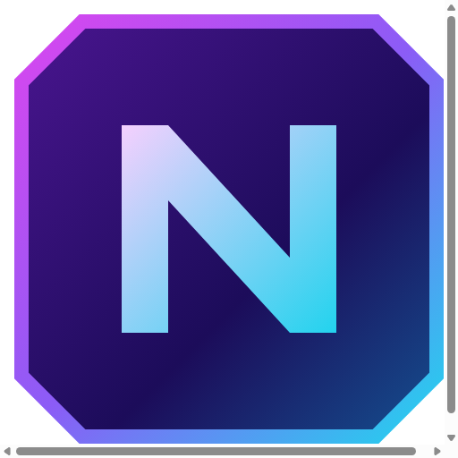
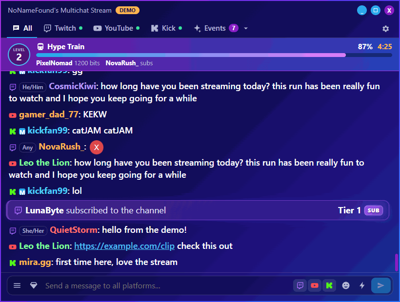
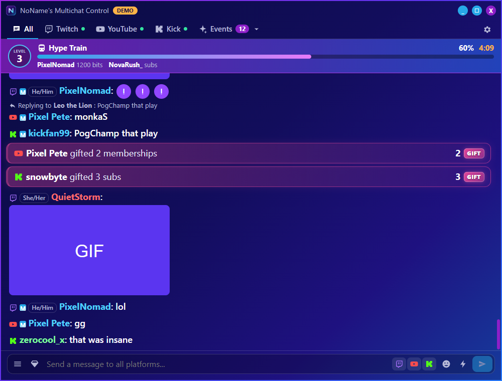
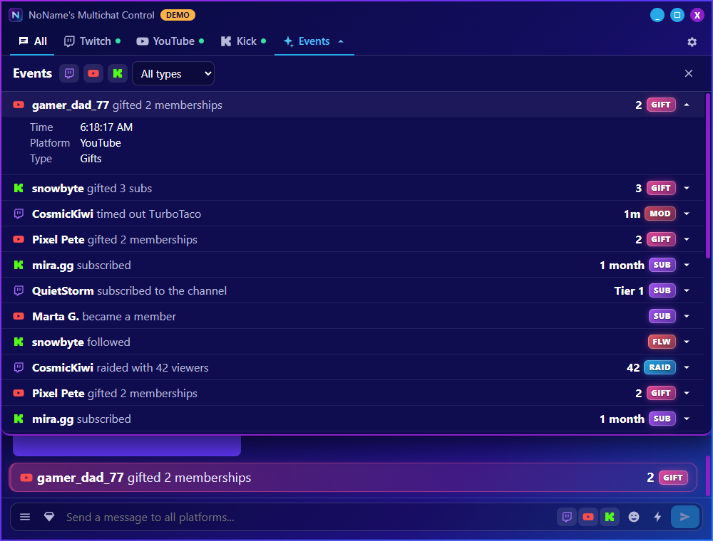
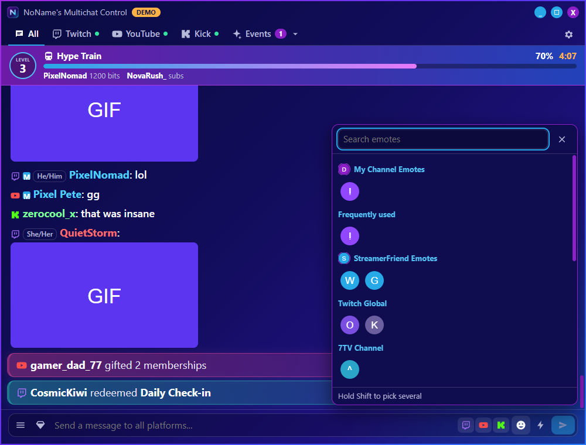
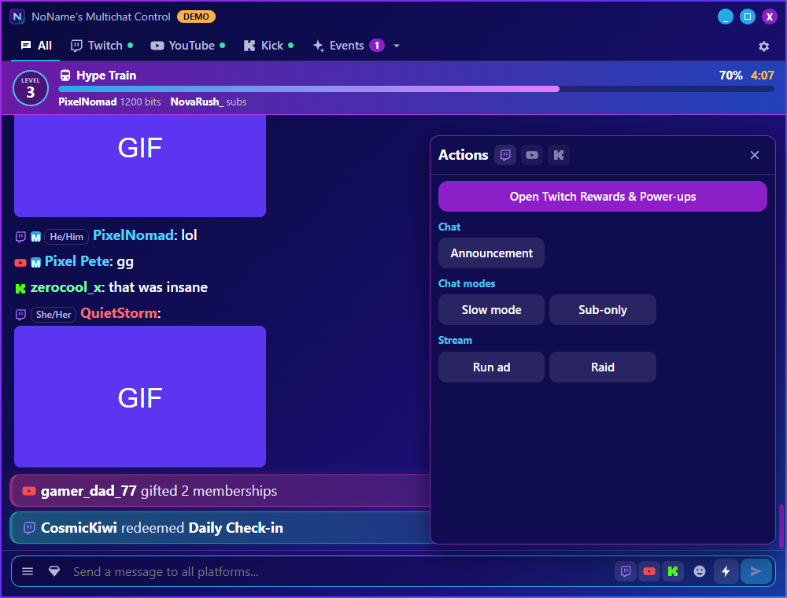
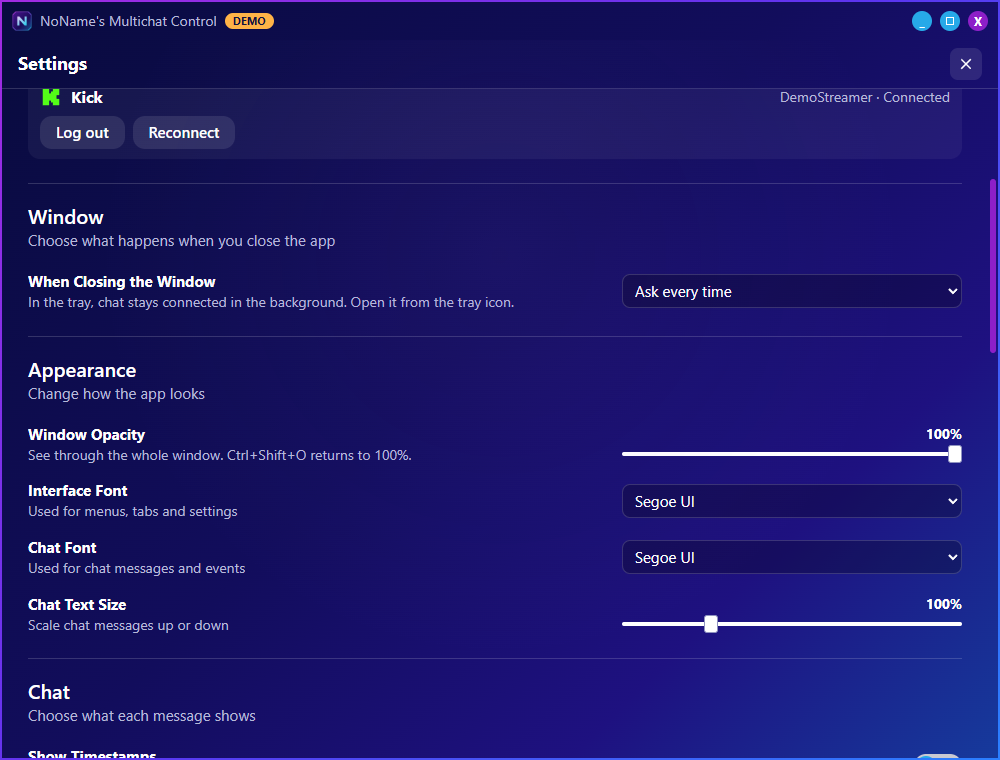

<div align="center">



# NoName's Multichat Control

**One window for every stream chat.**

Read and write Twitch, YouTube and Kick chat together, see every event as it happens, and run channel actions in one click. It's a single portable app with nothing else to install.


<br />



<sub>Everything shown here is built-in demo mode, with invented chatters and placeholder emotes.</sub>

</div>

---

## Why it exists

Streaming to several platforms usually means juggling browser tabs, or running a large bot suite just to read chat. NoName's Multichat Control is focused on the moment you're live: one merged chat, one list of events, and real controls within a click.

It doesn't need OBS, a bot, a server or a runtime. Each person logs in with their own accounts, so it works for any streamer.

> [!NOTE]
> This is an early release. The interface and message handling are covered by automated tests, but live use on all three platforms is still being tested. Please report anything that doesn't work.

## Features

<table>
<tr>
<td width="50%" valign="top">

### 💬 Unified chat
- **All, Twitch, YouTube and Kick** tabs
- On All, choose exactly where a message goes
- Each platform reports sent or failed on its own
- Pauses when you scroll, with a new-message count
- Reply, delete, time out, ban or shout out from any message

</td>
<td width="50%" valign="top">

### ⚡ Events and hype
- Subs, gifts, raids and redemptions as coloured cards in chat
- Gift bombs become one big card, not fifty rows
- Hype Train banner with level, progress and countdown
- Events drop-down over chat, closed with Esc
- A switch for each event type

</td>
</tr>
<tr>
<td valign="top">

### 😀 Emotes and media
- Picker that follows the active tab, with search
- Twitch, BetterTTV, 7TV, FrankerFaceZ and Kick emotes
- Animated cheermotes and Twitch chat GIFs
- Gigantified emotes and message effects
- Pronouns beside Twitch chatters

</td>
<td valign="top">

### 🎛️ One-click control
- Twitch's real Rewards & Power-ups panel inside the app
- Announcements, shoutouts, raids, ads and clips
- Slow, follower-only, sub-only and emote-only modes
- Shield mode, polls and predictions
- Stream title and category
- Keep running in the tray when you close the window

</td>
</tr>
</table>

## Screenshots

<table>
<tr>
<td align="center"><br /><b>Merged chat and live events</b></td>
<td align="center"><br /><b>Events drop-down</b></td>
</tr>
<tr>
<td align="center"><br /><b>Emote picker</b></td>
<td align="center"><br /><b>Quick actions</b></td>
</tr>
<tr>
<td align="center" colspan="2"><br /><b>Make it yours: opacity, fonts, text size and more</b></td>
</tr>
</table>

## Get started

### Run it

Download the portable exe from the [Releases](../../releases) page, when one is available, and run it from any folder. Or build it yourself:

```bash
git clone https://github.com/nnfisfree/multistreaming-app.git
cd multistreaming-app
npm install
npm run dist
```

You'll find the portable exe in `release/`. Building needs [Node.js](https://nodejs.org); running the exe doesn't.

Windows SmartScreen may warn on first run because the exe isn't code-signed. Choose **More info**, then **Run anyway**.

### Try it without an account

```bash
npm run demo
```

Demo mode simulates all three platforms, so you can explore everything except the real Twitch panel.

### Connect your accounts

Open the gear icon. Each platform has its own login and on-screen steps.

On an official release, click **Log in with Twitch**, **Log in with Google** or **Log in with Kick**, and sign in on the platform's own page: Twitch, your Google account for YouTube, or your Kick account for Kick. There's nothing else to set up.

Twitch expires its logins after about 30 days, so the app may ask you to log in again.

**Rewards panel:** click the gem icon and sign in to Twitch inside the panel once. This is a separate sign-in to Twitch's website, and it stays signed in.

<details>
<summary><b>Built it from source?</b></summary>

Twitch works as it is. YouTube and Kick need a developer app, because their credentials aren't stored in this repository. You can enter your own in Settings, under **Advanced** on each platform, or include them in your build.

**YouTube**

1. In the [Google Cloud console](https://console.cloud.google.com/apis/credentials), create a project and enable **YouTube Data API v3**.
2. Configure the OAuth consent screen, then **publish** it. Logins from an app left in Testing expire after 7 days.
3. Create an OAuth client ID of type **Desktop app**.

Google warns that an app is unverified until it passes Google's review.

**Kick**

1. At [kick.com/settings/developer](https://kick.com/settings/developer), enable developer mode and create an app.
2. Set the redirect URL to exactly `http://localhost:53682/callback`.
3. Enable all scopes.

**Including them in your build**

Copy `.env.example` to `.env.local`, fill it in, and run `npm run dist`. People using that build can then log in without any setup.

Never commit `.env.local`. Anything built into an exe can be extracted from it, so only do this with apps made for this purpose, and don't reuse their credentials elsewhere.

**Publishing your own builds?** Also register your own Twitch app as a **Public** client, and set its Client ID in `src/shared/app-config.ts`. A public Client ID isn't a secret.

</details>

## Good to know

These limits come from the platforms.

| Platform | Limit |
|---|---|
| **Twitch** | No public API can redeem a reward or Power-up, so the panel is Twitch's own page. **Power-ups there spend real Bits.** |
| **Twitch** | Only the app that created a reward can edit it or fulfil its redemptions. Rewards from the Twitch dashboard are read-only here, and their redemptions still appear in Events. |
| **Twitch** | The rewards panel depends on Twitch's page layout, so a Twitch redesign can stop it opening until the app is updated. Rewards that need a typed chat message must be redeemed in Twitch's normal chat. |
| **Twitch** | Pronouns come from the community service [pronouns.alejo.io](https://pronouns.alejo.io), so they cover Twitch chatters who registered there. Turning them on sends chatter names to that service. |
| **YouTube** | Until Google verifies this app, YouTube login on official builds only works for approved testers, and those logins expire every 7 days. |
| **YouTube** | Chat exists only during a live broadcast. The app waits and connects by itself. |
| **YouTube** | Each Google project gets 10,000 quota units a day, shared by everyone using that build. Each message sent costs 20. To avoid sharing, enter your own app in Settings. Messages are limited to 200 characters. |
| **YouTube** | Custom member emoji have no documented API, so they show as text and aren't in the picker. |
| **Kick** | Official events need a public web server, so **reading uses the same unofficial live connection as Kick's website**. Kick can change it without notice. Sending and moderation use the official API, and the app warns you if reading stops. |

## Privacy and security

- **Your data stays with you.** Settings and logins live in an `nnf-data` folder beside the exe, and the app has no server of its own. **Keep that folder private, because it holds your logins.**
- **Logins are encrypted** for your Windows user, so moving to another PC means logging in again.
- **Twitch's panel is isolated.** It runs in its own session and never sees the app's tokens.
- **Chat can't run code.** Messages are displayed as plain text, and links open only in your browser.
- **Third parties:** the app contacts the platforms you connect, plus BetterTTV, 7TV, FrankerFaceZ and pronouns.alejo.io for the features you leave on. Each can be turned off in Settings.

## Development

| Command | Purpose |
|---|---|
| `npm run demo` | Run with simulated platforms |
| `npm run dev` | Run with real connections |
| `npm test` | Unit tests |
| `npm run typecheck` | Type checking |
| `npm run build` | Build the app |
| `npm run test:ui` | Drive the built app through a UI test |
| `npm run test:contracts` | Check external APIs, with no account needed |
| `npm run dist` | Create the portable exe and zip |

In demo mode, sending a message containing `failkick` shows a partial send failure.

```text
src/
  main/       App process: logins, platform connectors, hub
    platforms/  One folder per platform behind a shared interface
  preload/    The narrow bridge between the app and the UI
  renderer/   React interface and theme
  shared/     Types and message parsing used on both sides
tests/        Unit tests
scripts/      UI test and contract checks
```

To add a platform, implement the `Connector` interface in `src/main/platforms/connector.ts`, and convert its messages to the shared types. The UI needs no platform-specific changes.

Contributions are welcome. Please run `npm test` and `npm run typecheck` before opening a pull request, and never include real chat logs, tokens or the `nnf-data` folder.

## License

[MIT](LICENSE). Use it, change it and share it.

<sub>NoName's Multichat Control is an independent project, and isn't affiliated with or endorsed by Twitch, YouTube, Kick, BetterTTV, 7TV or FrankerFaceZ. All trademarks belong to their owners.</sub>
