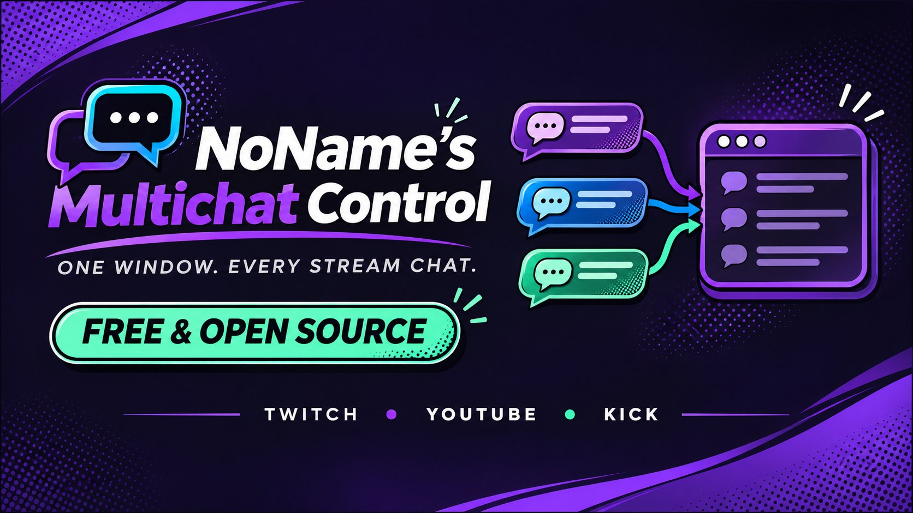
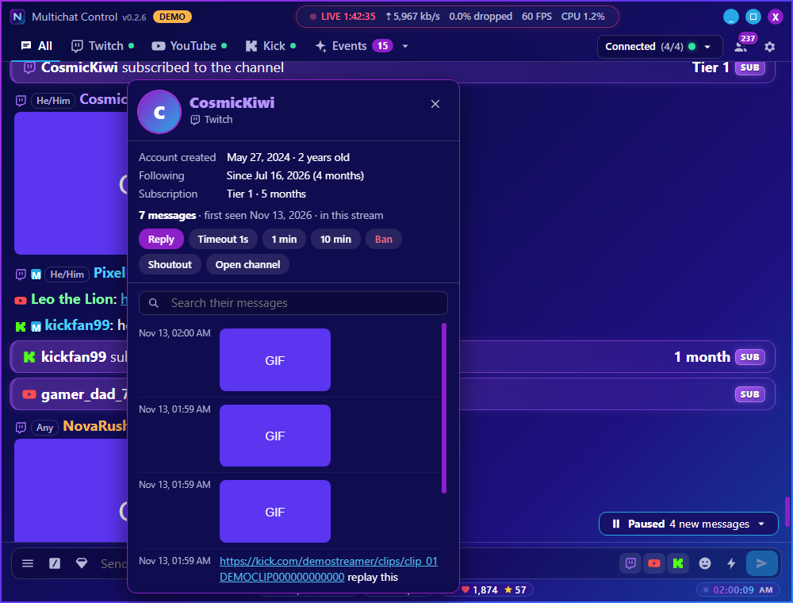
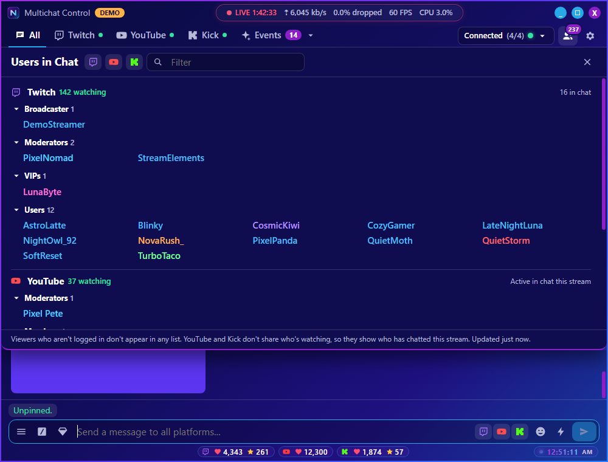
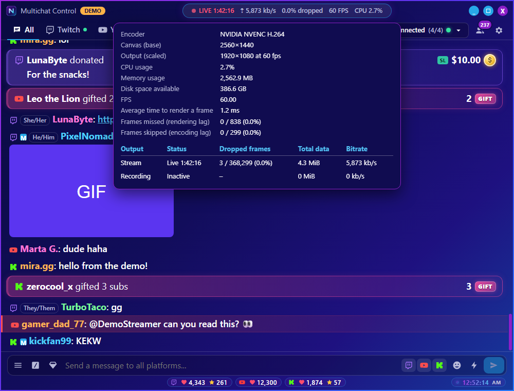
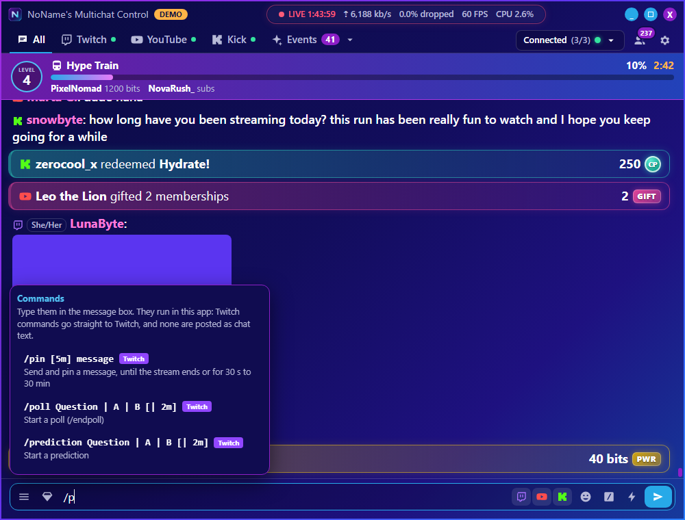
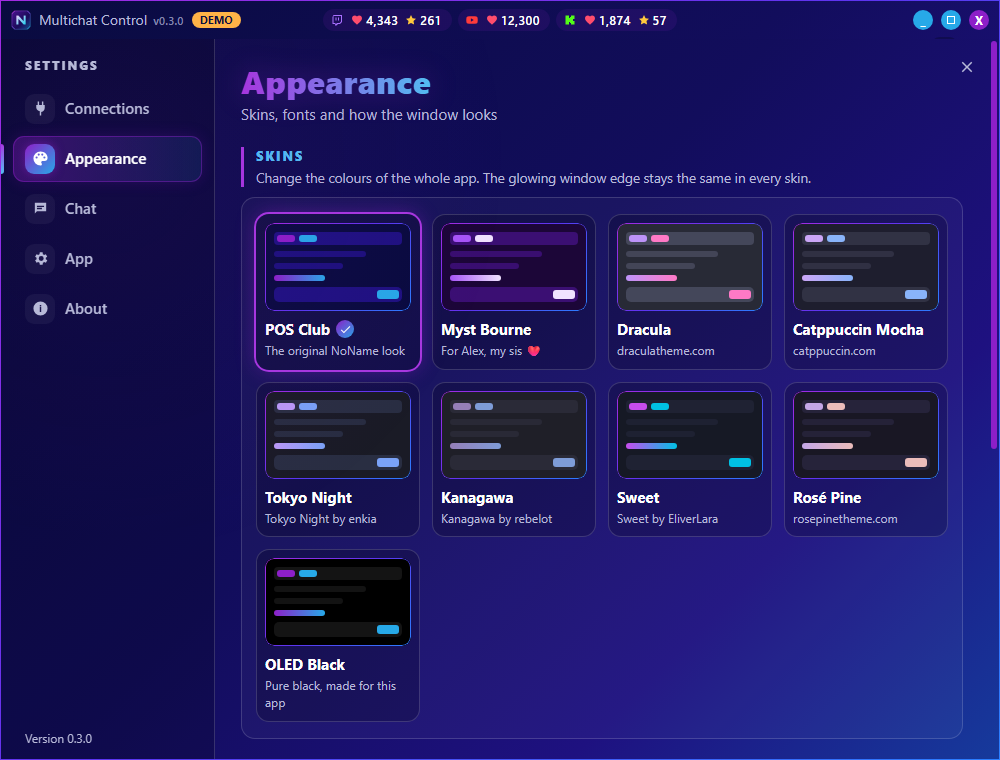
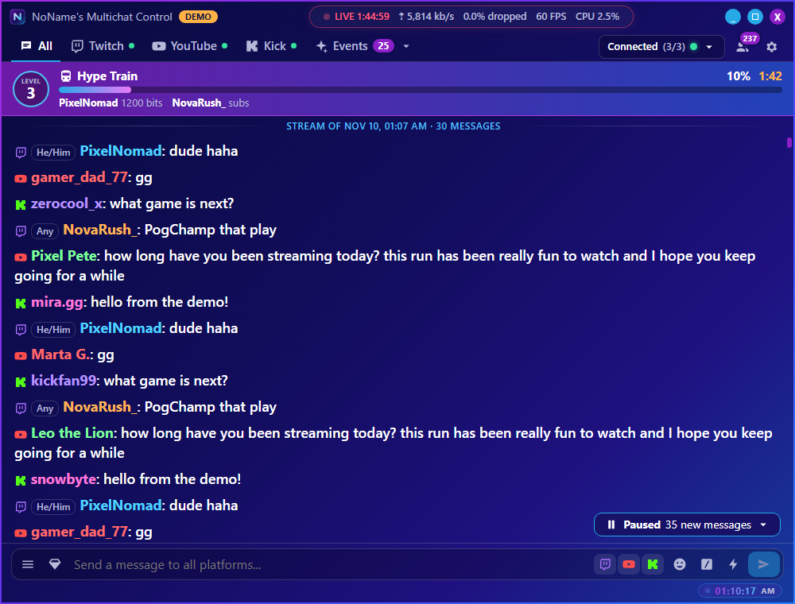
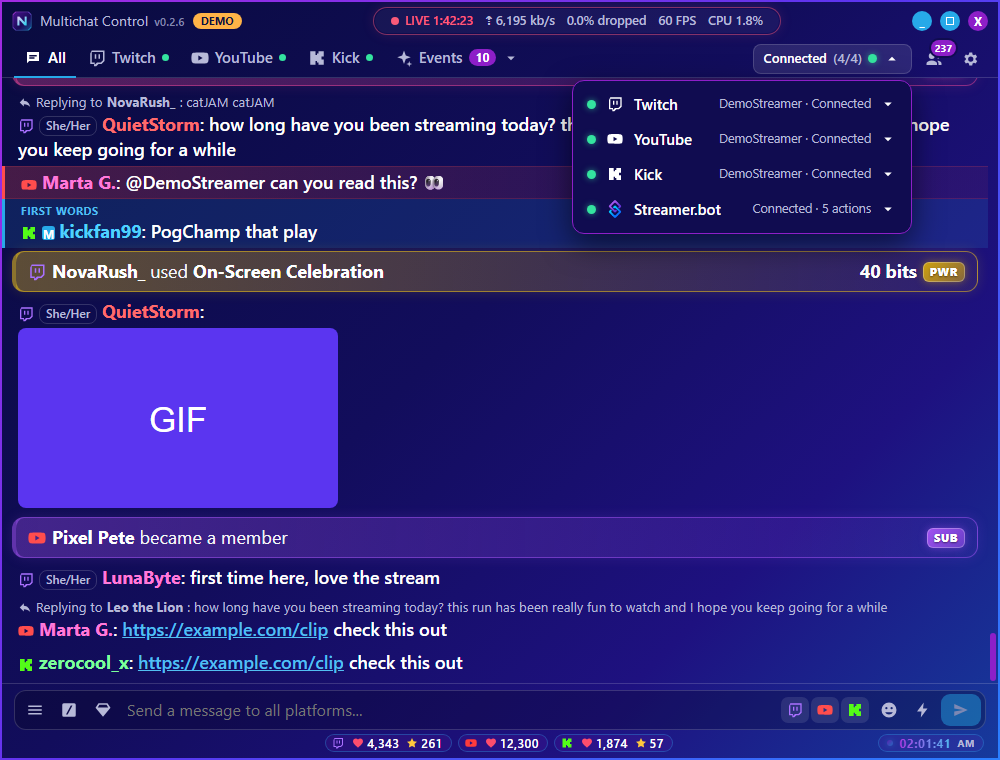
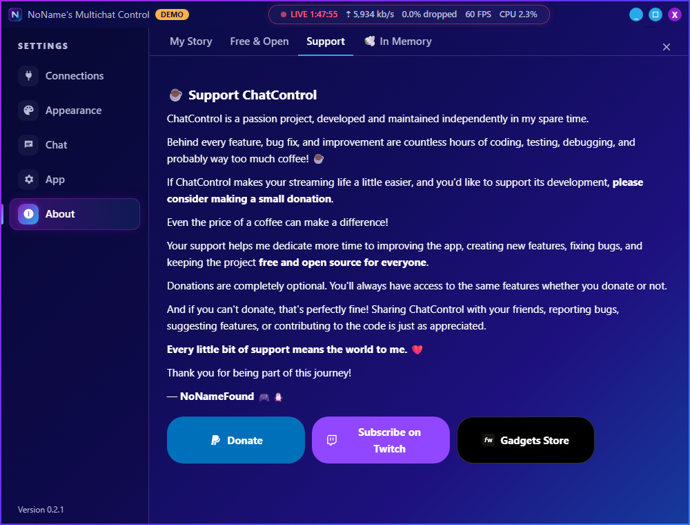

<div align="center">



<br />

[](https://github.com/nnfisfree/multichat-control/releases/latest)


[](LICENSE)

**Read and write Twitch, YouTube and Kick chat together, see every event as it happens, and run channel actions in one click.**
<br />
One small file, nothing else to install. It updates itself.

<br />


<sub>Every image here is built-in demo mode, with invented chatters and placeholder emotes.</sub>

</div>

---

## Why it exists

Streaming to several platforms usually means juggling browser tabs, or running a large bot suite just to read chat. NoName's Multichat Control is focused on the moment you're live: one merged chat, one list of events, and real controls within a click.

It doesn't need OBS, a bot, a server or a runtime. Each person logs in with their own accounts, so it works for any streamer.

**And it's light.** Version 0.2 was rebuilt on [Tauri](https://tauri.app): instead of shipping its own copy of Chromium, it uses Microsoft Edge WebView2, which is already part of Windows 10 and 11.

| | 0.1 | 0.2 |
|---|---|---|
| Download | 150 MB zip | **an 8 MB exe** |
| Beside the app | ~70 files and folders | **just `user-data`** |
| Memory while running | ~300 MB | **~230 MB** |

> [!NOTE]
> This is an early release, and live use on all three platforms is still being tested. Please [report](../../issues) anything that doesn't work.

## Features

<table>
<tr>
<td width="50%" valign="top">

### 💬 Unified chat
- **All, Twitch, YouTube and Kick** tabs
- On All, choose exactly where a message goes
- **Chat from your last 5 streams**, so you can read what you missed
- **Click any name for a user card**: account age, follow and sub, and everything they said in your channel
- **Users in Chat** for every platform, grouped Broadcaster · Moderators · VIPs · Users, with live viewer counts
- Reply, delete, time out (even for 1 second, to clear messages), ban or shout out

</td>
<td width="50%" valign="top">

### ⚡ Events and history
- Subs, gifts, raids and redemptions as coloured cards in chat
- **Recent events from every platform, in time order**, kept between sessions
- Filter by platform and type, sort newest or oldest first
- Your own test redeems are tagged, and cleared in one click
- Gift bombs become one big card, not fifty rows
- Hype Train banner with level, progress and countdown

</td>
</tr>
<tr>
<td valign="top">

### 💸 Alerts and donations
- **One-click login with Streamlabs** (StreamElements coming soon)
- Donations and tips arrive live, with past donations at start
- Fills in the past subs, gifts and Bits that platforms don't share
- The same event from two sources is shown only once

</td>
<td valign="top">

### 🎛️ One-click control
- Twitch's real Rewards & Power-ups panel, custom Power-ups included
- **Every Twitch chat command**, typed in the message box: raids, polls, predictions, modes, pins and more
- **Pinned messages** at the top of chat, out of the way during a Hype Train
- Announcements, shoutouts, raids, ads and clips in one click
- Shield mode, stream title and category

</td>
</tr>
<tr>
<td valign="top">

### 🎨 Skins and emotes
- **8 skins**: POS Club, Dracula, Catppuccin Mocha, Tokyo Night, Nord, Gruvbox Dark, Rosé Pine and OLED Black, Twitch's panel included
- Picker that follows the active tab, with search
- Twitch, BetterTTV, 7TV, FrankerFaceZ and Kick emotes
- Overlay emotes, animated cheermotes and Twitch chat GIFs
- Pronouns beside Twitch chatters

</td>
<td valign="top">

### 📈 Stream health and updates
- **OBS stats in the title bar**: live, uptime, bitrate, dropped frames, FPS and CPU
- Click for everything: encoder, canvas and output resolution, render and encoding lag
- A status menu for every connection, with reconnect and log in
- Installs new versions in one click, checked against GitHub's checksum

</td>
</tr>
</table>

## Screenshots

<table>
<tr>
<td align="center"><br /><b>Every chat in one place, with your stream's health on top</b></td>
<td align="center"><br /><b>Know who you're talking to</b></td>
</tr>
<tr>
<td align="center"><br /><b>Who's in chat, on every platform</b></td>
<td align="center"><br /><b>OBS stats at a glance</b></td>
</tr>
<tr>
<td align="center"><br /><b>Recent events, filtered, sorted and tidy</b></td>
<td align="center"><br /><b>Every Twitch command, suggested as you type</b></td>
</tr>
<tr>
<td align="center"><br /><b>Eight skins, one click each</b></td>
<td align="center"><br /><b>Read what you missed in your last streams</b></td>
</tr>
<tr>
<td align="center"><br /><b>Every connection at a glance</b></td>
<td align="center"><br /><b>Emote picker for every provider</b></td>
</tr>
<tr>
<td align="center"><br /><b>Clear settings, one-click logins</b></td>
<td align="center"><br /><b>The story behind it, inside the app</b></td>
</tr>
</table>

## Get started

### Download

1. Get the latest version from **[Releases](https://github.com/nnfisfree/multichat-control/releases/latest)**: **`Multichat-Control-x.y.z-portable.exe`** is the whole app in one file. Put it in its own folder (it keeps its data in a `user-data` folder next to itself) and run it.
2. Windows SmartScreen may warn on first run because the exe isn't code-signed. Choose **More info**, then **Run anyway**.

That's it. Future versions arrive through the app's own update banner.

**Using version 0.1?** Click **Update** in the app as usual. Your settings, logins, saved events and chat history carry over, and the old version's files are removed. The rewards panel asks you to sign in to Twitch once more.

**Missing WebView2?** It's part of Windows 10 and 11, so this is rare. If it's missing, the app says so and offers [Microsoft's free installer](https://go.microsoft.com/fwlink/p/?LinkId=2124703).

### Connect your accounts

Open the gear icon and click **Log in** beside each platform you stream on. You sign in on the platform's own page: Twitch, your Google account for YouTube, or your Kick account. There's nothing else to set up.

- **Twitch** expires its logins after about 30 days, so the app may ask you to log in again.
- **Rewards panel:** click the gem icon, then **Sign in to Twitch** inside the panel once. This is a separate sign-in to Twitch's website, and it stays signed in. Your custom Power-ups and points only show once you're signed in.
- **Alerts & Donations:** pick the one service you use and click **Log in**.
- **The status menu** next to the gear shows every connection. Click a row to reconnect or log in.
- **Users in Chat and some commands** need a newer Twitch login. If the app asks, click **Log in again** once.
- **OBS stats (optional):** in OBS, open **Tools → WebSocket Server Settings**, tick **Enable WebSocket server**, and copy the **Server Password** from **Show Connect Info**. Then turn on **Settings → Connections → OBS Studio → Show OBS Stats** and paste it. The app only reads from OBS and never changes anything there.
- **Skins:** **Settings → Appearance**. The window edge keeps its glow in every skin.

### Commands

Type these in the message box. The **/** button lists them, and the list narrows as you type. None are posted as chat text.

| Command | What it does |
|---|---|
| `/clearhistory` | Clears the chat in the app and deletes the saved chat of past streams. Your viewers' chat isn't affected. |

**Twitch** commands go straight to Twitch, whichever tab is open:

| Command | What it does |
|---|---|
| `/raid channel` | Raid another channel (`/unraid` cancels) |
| `/pin [5m] message` | Send and pin a message, until the stream ends or for 30 s to 30 min (`/unpin`) |
| `/announce message` | Send an announcement (also `/announceblue`, `green`, `orange`, `purple`) |
| `/shoutout channel` | Give a shoutout (also `/so`) |
| `/timeout name [10m] [reason]` | Time someone out, 1 s to 2 weeks, 10 min if no time (`/untimeout`) |
| `/ban name [reason]` | Ban someone (`/unban`) |
| `/warn name reason` | Send someone a warning they must acknowledge |
| `/clear` | Clear chat for everyone |
| `/slow [30]` | Slow mode, 3 to 120 seconds (`/slowoff`) |
| `/followers [10m]` | Followers-only chat (`/followersoff`) |
| `/subscribers` | Subscribers-only chat (`/subscribersoff`) |
| `/emoteonly` | Emote-only chat (`/emoteonlyoff`) |
| `/uniquechat` | No repeated messages (`/uniquechatoff`) |
| `/shield` | Shield mode (`/shieldoff`) |
| `/mod name`, `/vip name` | Make someone a moderator or VIP (`/unmod`, `/unvip`) |
| `/mods`, `/vips` | List the moderators or VIPs |
| `/user name` | Open their user card |
| `/commercial [60]` | Run an ad, up to 180 seconds |
| `/marker [description]` | Add a stream marker for highlights |
| `/title new title` | Change the stream title |
| `/game name` | Change the category (also `/category`) |
| `/poll Question \| A \| B [\| 2m]` | Start a poll (`/endpoll`) |
| `/prediction Question \| A \| B [\| 2m]` | Start a prediction |
| `/color blue_violet` | Change your name colour |
| `/w name message` | Whisper someone (also `/whisper`) |
| `/block name` | Block someone (`/unblock`) |

You can also right-click any Twitch message and choose **Pin message**.

### Try it without an account

Start the app with `--demo`, or from source:

```bash
npm run demo
```

Demo mode simulates all three platforms, so you can explore everything except the real Twitch panel.

<details>
<summary><b>Build it from source</b></summary>

You need:

- [Node.js](https://nodejs.org) 20 or newer
- [Rust](https://rustup.rs) (stable, with the default MSVC toolchain)
- [Visual Studio Build Tools](https://visualstudio.microsoft.com/visual-cpp-build-tools/) with **Desktop development with C++**
- WebView2, which Windows 10 and 11 already have

```bash
git clone https://github.com/nnfisfree/multichat-control.git
cd multichat-control
npm install
npm run build
```

You'll find the app at `core/target/release/Multichat-Control.exe`. Running it needs none of the tools above.

`npm run build` keeps your PC's folder paths out of the exe. Building with plain `tauri build` works too, but Rust then embeds your user folder in the exe's error messages.

Twitch works as it is. YouTube, Kick, Streamlabs and StreamElements need a developer app, because their credentials aren't stored in this repository. For YouTube and Kick you can enter your own in Settings, under **Advanced**, or include them all in your build.

**YouTube**

1. In the [Google Cloud console](https://console.cloud.google.com/apis/credentials), create a project and enable **YouTube Data API v3**.
2. Configure the OAuth consent screen, then **publish** it. Logins from an app left in Testing expire after 7 days.
3. Create an OAuth client ID of type **Desktop app**.

Google warns that an app is unverified until it passes Google's review.

**Kick**

1. At [kick.com/settings/developer](https://kick.com/settings/developer), enable developer mode and create an app.
2. Set the redirect URL to exactly `http://localhost:53682/callback`.
3. Enable all scopes.

**Streamlabs**

1. [Register an app](https://streamlabs.com/dashboard#/oauth-clients/register) with the redirect URL `http://localhost:53683/streamlabs` and the scopes `donations.read` and `socket.token`.
2. Until Streamlabs approves it, only the accounts you whitelist (up to 10) can log in.

**StreamElements**

StreamElements gives out app credentials on request. Use the redirect URL `http://localhost:53683/streamelements` and the scopes `channel:read activities:read tips:read`.

**Including them in your build**

Copy `.env.example` to `.env.local`, fill it in, and run `npm run build`. People using that build can then log in without any setup.

Never commit `.env.local`. Anything built into an exe can be extracted from it, so only do this with apps made for this purpose, and don't reuse their credentials elsewhere.

**Publishing your own builds?** Also register your own Twitch app as a **Public** client. A Confidential app can log in, but its logins drop after about 4 hours. Set its Client ID as `TWITCH_CLIENT_ID` in `core/src/auth.rs`. A public Client ID isn't a secret. Then set `UPDATE_REPO` in `core/src/updater.rs` to your repository, so your users get your updates.

</details>

## Good to know

These limits come from the platforms.

| Platform | Limit |
|---|---|
| **Twitch** | No public API can redeem a reward or Power-up, so the panel is Twitch's own page. **Power-ups there spend real Bits.** |
| **Twitch** | Only the app that created a reward can edit it or fulfil its redemptions. Rewards from the Twitch dashboard are read-only here, and their redemptions still appear in Events. |
| **Twitch** | The API keeps dated history only for follows, past streams, polls, predictions and the Hype Train record. Subs, gifts, Bits and raids from before the app started come from Streamlabs or StreamElements, or build up as the app sees them. |
| **Twitch** | The rewards panel depends on Twitch's page layout, so a Twitch redesign can stop it opening until the app is updated. Rewards that need a typed chat message must be redeemed in Twitch's normal chat. |
| **Twitch** | Twitch sends no notice when a message is pinned, so the pinned bar checks every 20 seconds. |
| **Twitch** | Pronouns come from the community service [pronouns.alejo.io](https://pronouns.alejo.io), so they cover Twitch chatters who registered there. Turning them on sends chatter names to that service. |
| **YouTube** | Until Google verifies this app, YouTube login on official builds only works for approved testers, and those logins expire every 7 days. |
| **YouTube** | Chat exists only during a live broadcast. The app waits and connects by itself. |
| **YouTube** | Each Google project gets 10,000 quota units a day, shared by everyone using that build. Each message sent costs 20. To avoid sharing, enter your own app in Settings. Messages are limited to 200 characters. |
| **YouTube** | Custom member emoji have no documented API, so they show as text and aren't in the picker. |
| **All** | Platforms only list viewers who are logged in. **Twitch** shares who is in chat; **YouTube** and **Kick** don't share who is watching, so their lists show who has chatted this stream, next to the viewer count. |
| **All** | The user card's history covers your channel only: this stream plus the saved chat of your last 5 streams. No platform shares what someone said elsewhere. |
| **Kick** | Kick only times people out in whole minutes, so **Timeout 1 second** deletes that user's recent messages instead. Follow and sub details on the user card come from Kick's website data and can be missing. |
| **Kick** | Official events need a public web server, so **reading uses the same unofficial live connection as Kick's website**. Kick can change it without notice. Sending and moderation use the official API, and the app warns you if reading stops. |
| **Streamlabs** | Keeps a history of donations only. Its other alerts arrive live. |

## Privacy and security

- **Your data stays with you.** Settings, logins, saved events and chat history live in a `user-data` folder beside the exe, and the app has no server of its own. **Keep that folder private, because it holds your logins.**
- **Logins are encrypted** with Windows' own protection for your Windows user, so moving to another PC means logging in again. The OBS WebSocket password is stored the same way.
- **Logins never reach the app's window.** The part of the app written in Rust keeps them, adds them to each request itself, and only ever sends each one to that service's own servers.
- **OBS is read-only.** The app only reads stats from OBS on this PC; it never switches scenes or starts or stops anything.
- **Chat history stays on your PC.** The last 5 streams are kept in `user-data`, with deleted messages saved only as deleted. Turn it off under Settings → Chat, or type `/clearhistory` to delete it.
- **Coming from version 0.1?** Everything carries over: the app reads 0.1's files and logins on first start. From 0.1.2 or earlier, the `nnf-data` folder is renamed to `user-data` too.
- **Updates are verified.** The app only installs a download that matches GitHub's checksum, and never touches `user-data`.
- **Twitch's panel is isolated.** It's Twitch's own page and can't reach the app or its logins; links to other sites open in your browser.
- **Chat can't run code.** Messages are displayed as plain text, and links open only in your browser.
- **Third parties:** the app contacts the platforms and alert service you connect, GitHub to check for updates, plus BetterTTV, 7TV, FrankerFaceZ and pronouns.alejo.io for the features you leave on. Each can be turned off in Settings.

## Support the project

NoName's Multichat Control is free and open source, and it always will be. It's built in my spare time, so if it makes your streams easier, you can help keep it going:

<div align="center">

[](https://streamelements.com/nonamefound/tip)
[](https://www.twitch.tv/subs/nonamefound)
[![Gadgets Store](https://img.shields.io/badge/Gadgets%20Store-000000?style=for-the-badge&logo=data%3Aimage%2Fpng%3Bbase64%2CiVBORw0KGgoAAAANSUhEUgAAABwAAAAcCAYAAAByDd%2BUAAADzUlEQVR4nLxWTUxTQRD%2B%2BnivLXAgAi0aBBRjRSJqNEq9eAATjWev%2Fh80MSbe1HgUjVeNUaOeNDF6lpD4gz9J1RZti1BIpCRUBBL%2BKX9aCu%2B5M3TJo7RNRGCSl327OzvfzDe7s6s6HOteWhQcNQwYABSLEKygGEKoIauGjgaLsyjfkBMrDWYGlbZV8a%2BLlvqW1QCVNmWkymqCIWHcZNuiSpDVotNsm1olk%2BI8C6y48Mmx5YqaCSwrKwtzc3OIxWLQdR2KosBms%2FHccglR04GR8ampKdjtdpRvLodm1RCfiaOntwf%2Fw76SCowii8X%2BYM%2BevWhs%2FAifzw%2Bf148bN25hcnISmqotREm69JkdpT61qehXk8HIyOzsLMZGp1B3%2FSaqdlQh3BlG49s3aGiox%2B%2FpOMbVceTk5GBmZgbT09O8Njc3F5qmYWJigterqspjyfQvAqQJyhkZO3fuGKqqdnK%2FqcmH5y%2BewekswqnTxzEwMACPx4Oy0lJmgaTpaxP6%2BnpRU1OL%2FPx8DAodr8%2FLwIswZKVhfpUsDA8P4vz5C7hz%2By6DETXSQ6%2F3C9zuA%2Bju7kb5lk24cvkK6upu8tylSxfx6PFD%2FIz0orCwEE%2BfPsGZsyfhcDjYThpKdRFdLlpavuP1m1eorTkkcjaB%2Bw%2FuIRgIiAid2LdvPwoKClBcvAFlZWULeSoR0ZaUlCIvL48B3n94lzKPiwBp6xPvHz94cOL4L05%2BR0cHrl27itk4UFN7kKMlne3bK%2BFybUN%2Ffz%2FnbpurApWVlfxPuW1vDy0cobSAZCwej8PhXIfqajcrt7e3sRGnGAuHw5yn4uKNcFcfEIAuQfNnZIucV1RUcPS0pqurS3yRlIBLjgV5t2H9PF3kQPP3Zt519D80NIQ24QDJ4cNHUFS0Ht%2F83xAMBoT%2BJk4BSSjUgmh0lDdMRkDinKrK1q0uziXlIhRq5UNPQtEHA36mfteu3TxGDJAO0b9DHCFd7AO%2FcIJ0ZDnMSClFU%2B12M3g0GkVnZydsVhsbII%2F9fj8bp6NDEolERE5zWF%2BOBUTEmmblNcmStGkMWK1WriTNzUH2fGRkmMco2uxsO0JtrfhCebNnYyw6Js5kP89%2F%2BuThzTQ%2BHhUb7QeXxFSVZtE5lFWBjMuzQxtG3hLUktdEraSK5iXdCSscnXlNRkplLZ2vjxY2IBfKWim9N19X5luE2nQ3StrrSXqbaqEEMVOWaiyVLAFMNm7u%2F8u1lE5XwRqLknhNyffjqogZQ0m05qfcioOZn4mqfEit1TNRMXSjnh%2FhiUixwpKwqROGoev1fwEAAP%2F%2FYS96FAAAAAZJREFUAwDZbiCuC53RGgAAAABJRU5ErkJggg%3D%3D)](https://nonamefound.lol/en-eur)

</div>

Donations are optional, and everyone gets the same features. Sharing the app, reporting bugs, suggesting features or contributing code helps just as much. ❤️

## Development

| Command | Purpose |
|---|---|
| `npm run demo` | Run with simulated platforms |
| `npm run dev` | Run with real connections |
| `npm run typecheck` | Type checking |
| `npm run build` | Build `core/target/release/Multichat-Control.exe` |
| `npm run release -- --dry` | Build both downloads into `release/` and check them for personal data, without publishing |
| `npm run release -- --notes notes.md` | Build, check for personal data, and publish a GitHub release (`--pre` for a test version) |

```text
ui/            The interface (React): components, skins and styles
engine/        The app's logic (TypeScript): the hub that merges chats, one connector per
  platforms/   platform behind a shared interface, alert services, OBS, demo mode
core/          The Rust side (Tauri): window, logins and tokens, encrypted secrets, files,
  src/         YouTube's live chat, Twitch's rewards panel, updater, tray
shared/        Types and message parsing used by the interface and the engine
assets/        Icon and logos
proto/         YouTube's live chat definition
scripts/       The build and release commands
docs/media/    README images
```

To add a platform, implement the `Connector` interface in `engine/platforms/connector.ts`, and convert its messages to the shared types. If it needs a login, add it to `core/src/auth.rs`. The interface needs no platform-specific changes.

Contributions are welcome. Please run `npm run typecheck` before opening a pull request, and never include real chat logs, tokens or the `user-data` folder.

## License

[MIT](LICENSE). Use it, change it and share it.

<sub>NoName's Multichat Control is an independent project, and isn't affiliated with or endorsed by Twitch, YouTube, Kick, Streamlabs, StreamElements, Fourthwall, BetterTTV, 7TV or FrankerFaceZ. All trademarks belong to their owners.</sub>
