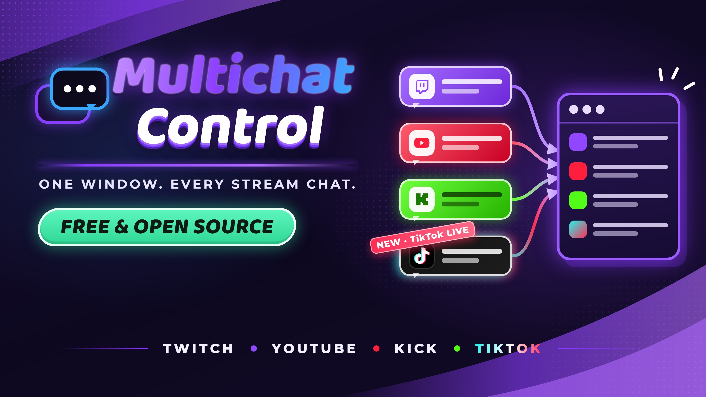
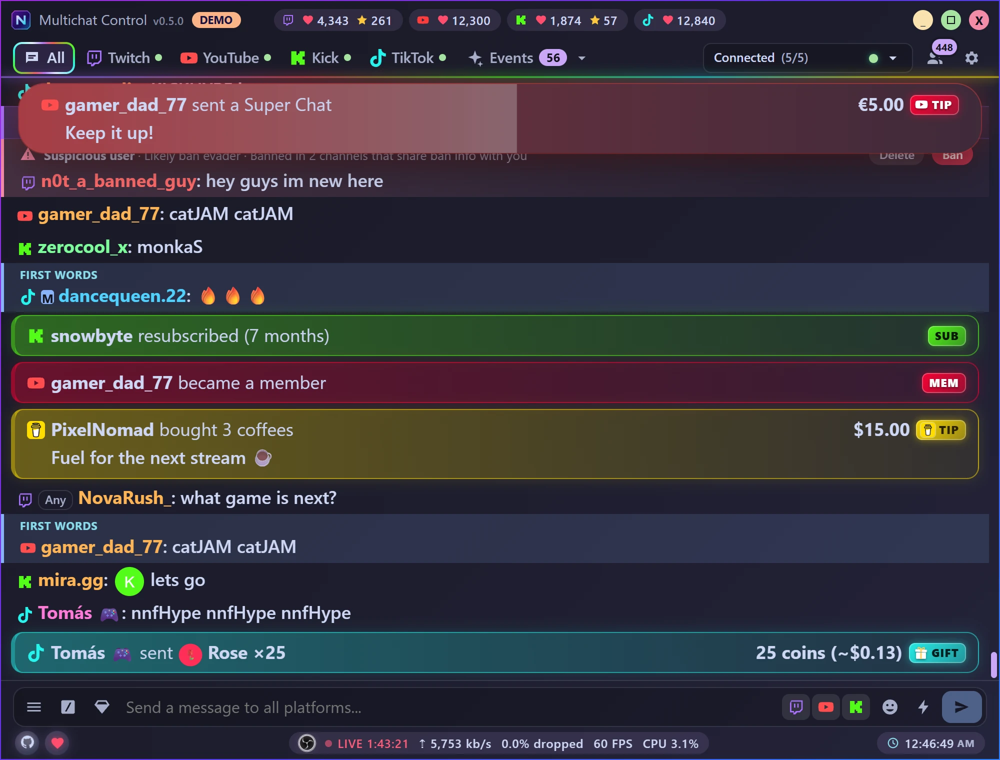
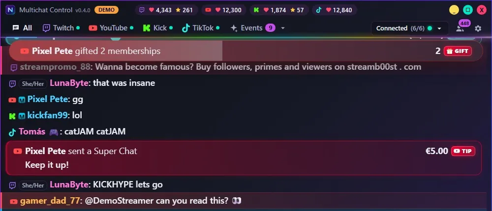
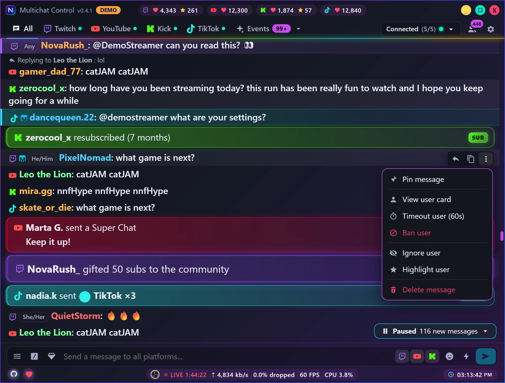
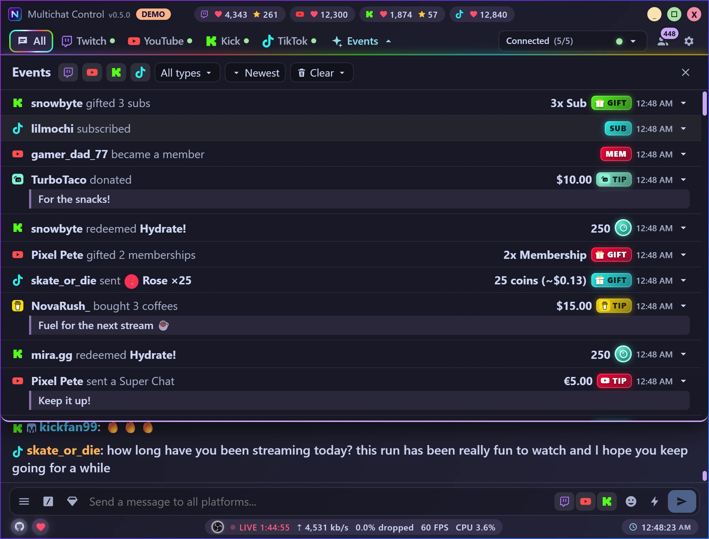
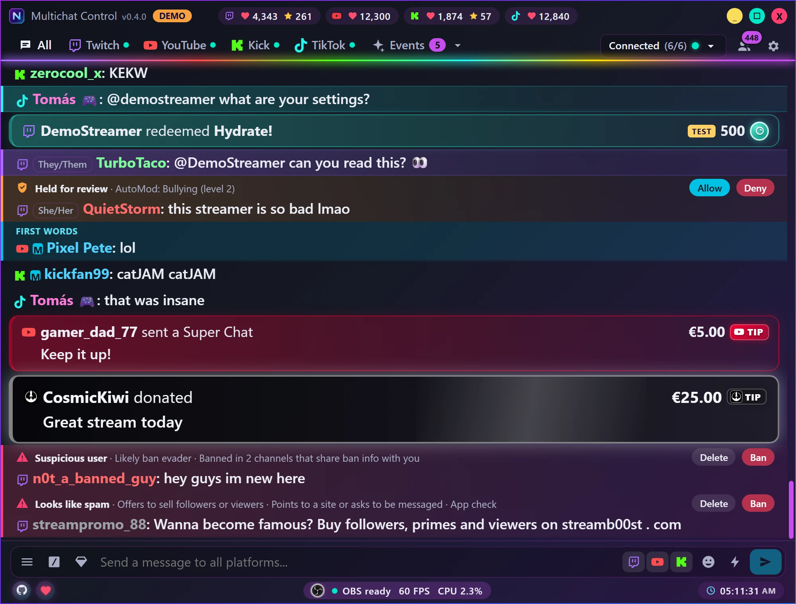
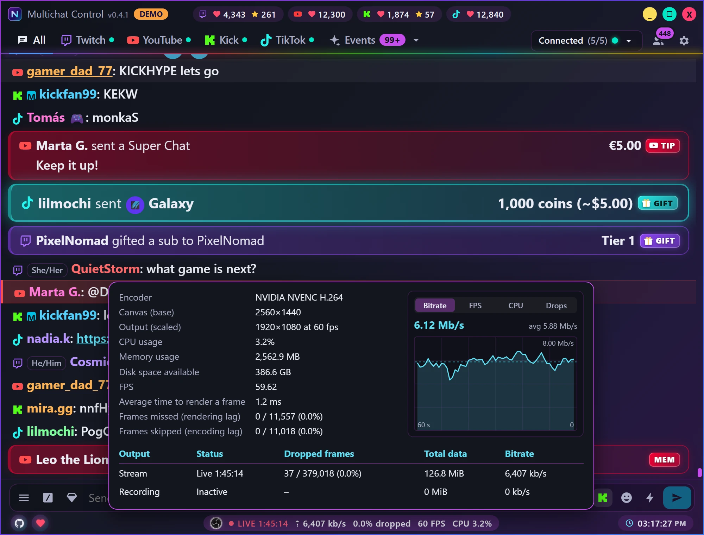
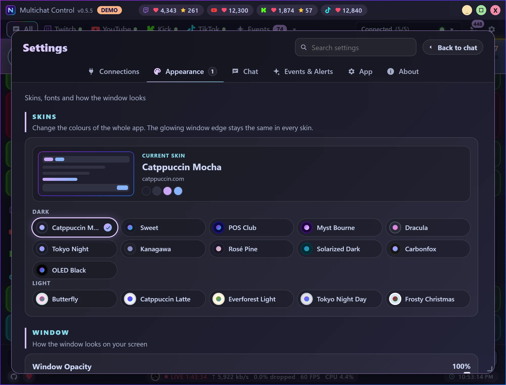

<div align="center">



<br />

[](https://github.com/nnfisfree/multichat-control/releases/latest)


[](LICENSE)
[](https://github.com/sponsors/nnfisfree)


### One window. Every stream chat.

**Read and write Twitch, YouTube and Kick chat together, read TikTok LIVE right next to them,<br />see every event as it happens, and run your channel in one click.**

One small file, nothing else to install. It updates itself.

💪 *Inspired by [Streamer.bot](https://streamer.bot)'s [chat](https://docs.streamer.bot/guide/extra-features/chat), but on steroids.*

<br />

**[Download](https://github.com/nnfisfree/multichat-control/releases/latest)** &nbsp;·&nbsp;
**[Features](#-features)** &nbsp;·&nbsp;
**[Screenshots](#-screenshots)** &nbsp;·&nbsp;
**[Get started](#-get-started)** &nbsp;·&nbsp;
**[Commands](#%EF%B8%8F-commands)** &nbsp;·&nbsp;
**[Good to know](#-good-to-know)** &nbsp;·&nbsp;
**[Support](#-support-the-project)**

<br />



<sub>Every image here is the built-in demo mode, with invented chatters and placeholder emotes.</sub>

</div>

<br />

> [!TIP]
> ### 🎉 New in 0.5.0
> **StreamElements and Streamlabs are here:** log in to your own account right inside the app with one click, and your last 30 days of tips, subs, gifts, cheers and raids land in Events, with new alerts live. **Gift bombs are one line** with how many and which tier (**5x Tier 1**), **Up** in the message box brings back what you sent, the open tab gets a glowing frame, the stats bar names your streaming app and its version, the Connections menu is smaller, and there's a new skin, **Carbonfox**. New installs start on **Catppuccin Mocha**. [How to set it up](#-get-started)

## 🚀 Features

<table>
<tr>
<td width="50%" valign="top">

### 💬 Unified chat
- **All, Twitch, YouTube, Kick and TikTok** tabs, each shown only while that platform is connected
- On All, choose exactly where a message goes
- **Chat from your last 5 streams**, so you can read what you missed
- **Messages that tag you stand out** in the colour of their platform: purple Twitch, red YouTube, green Kick, cyan TikTok
- **Click any name for a user card**: account age, follow and sub, badges and everything they said in your channel
- **Users in Chat** for every platform, grouped Broadcaster · Moderators · VIPs · Users, with live viewer counts
- **Previews for videos and clips**: YouTube links and Twitch, Kick or YouTube clips get a card with picture, length, title and channel
- **Point at a message** for Reply, Copy and a ⋮ menu: pin, user card, Twitch's viewer card, timeout, ban, delete
- **Press Up** in the message box to bring back what you sent this session, Down to go forward again
- **Ignore** someone to hide their messages, or **highlight** them in gold, on this PC only
- **Username colours per platform**: their own, the platform colour, random per person or one colour, plus colours per role
- Right-click for more: time out for 1 second (clears their messages), 1 or 10 minutes, or shout out

</td>
<td width="50%" valign="top">

### ⚡ Events and pop-ups
- Subs, gifts, raids, redemptions, follows and donations as cards in chat, **in the official colour of their platform**
- **TikTok gifts** with their picture, price in coins and roughly what you earn; streaks land as one card
- **Event pop-ups** at the top of chat, one at a time. Hover to keep one, click to close it
- **A wave of follows becomes one pop-up** ("Sam and 5 others"), and big cheers stay longer
- **Resub months at a glance**: SUB ×14 on the pop-up, months and streak in Recent events
- **The supporter's message always shows**: resubs, cheers, Super Chats and tips
- **Recent events from every platform**, in time order, kept between sessions, with filters
- **You choose where each event shows**, per platform: in chat, in the Events tab, or both. The Events badge only counts what you picked
- **Test alerts** from Streamer.bot, StreamElements and Streamlabs tagged **TEST** and never saved
- **Twitch Power-ups as on Twitch**: RGB Message Effects, giant emotes, On-Screen Celebrations
- **Gift bombs in one line** with how many and which tier: **5x Tier 1**, **3x Sub** on Kick, **2x Membership** on YouTube
- Hype Train banner, and animated icons on every badge

</td>
</tr>
<tr>
<td valign="top">

### 🛡️ Moderation
- **Messages held by Twitch's AutoMod** appear with the reason and **Allow** / **Deny**
- **Suspicious users** flagged by Twitch, like likely ban evaders, highlighted with Twitch's reasons
- **"Buy followers" spam bots** marked on Twitch, Kick and YouTube
- **Delete** and **Ban** right on the warning: a bot is gone in one click

### 🤖 Streamer.bot
- **Run any action** from the message box: `/sb Action name`, with text passed along
- The list **follows Streamer.bot live**, chat commands (like `!lurk`) included
- **Test triggers** show up in chat and Events, so you can try alerts while offline

</td>
<td valign="top">

### 🎛️ One-click control
- Twitch's real **Rewards & Power-ups panel**, custom Power-ups included
- **Every Twitch chat command** in the message box: raids, polls, predictions, modes, pins and more
- **The / list**, split into Twitch, app and Streamer.bot commands, with search
- **Raid bar** like OBS's: picture, game, viewers, title, countdown, **Raid Now** and Cancel
- **Pinned messages** at the top of chat
- Announcements, shoutouts, ads, clips, shield mode, title and category

### 💸 Alerts
-  **Buy Me a Coffee** tips, memberships and shop sales live in chat, with **how many months** each member has supported you
- **StreamElements** and **Streamlabs**: log in to your own account inside the app in one click (the window closes by itself), and your **last 30 days** of tips, subs, gifts, cheers and raids plus **live alerts** show up in Events
- Twitch, YouTube and Kick stay the first source: nothing is listed twice, and what you missed while the app was closed fills in quietly

</td>
</tr>
<tr>
<td valign="top">

### 🎨 Look and feel
- **15 skins**, dark and light, with a big live preview: Catppuccin Mocha (the default), Sweet, POS Club, Myst Bourne, Dracula, Tokyo Night, Kanagawa, Rosé Pine, Solarized Dark, Carbonfox, OLED Black, Butterfly, Catppuccin Latte, Everforest Light, Tokyo Night Day
- **A glowing frame** around the open tab, its colours circling round, gliding over when you switch
- **A comet line** under the tabs in your platforms' colours, that turns red if one drops
- **Wobbly window**, inspired by KDE Plasma: it bends like jelly while you drag it
- **Remembers its size and place**, monitor included
- Twitch, BetterTTV, 7TV, FrankerFaceZ and Kick emotes, overlay emotes, cheermotes and GIFs
- Pronouns beside Twitch chatters

</td>
<td valign="top">

### 📈 Stream health
- **Live stats under the message box** from **OBS Studio, Streamlabs Desktop or Meld Studio**: uptime, bitrate, dropped frames, FPS and CPU, with the app's name and version once it connects
- **Point at them for a 60-second live graph**, like a system monitor
- Click for everything: encoder, resolutions, render and encoding lag
- **Followers and subscribers** of every platform in the title bar
- A clock, a status menu for every connection, and **one-click updates** checked against GitHub's checksum

</td>
</tr>
</table>

## 📸 Screenshots

<table>
<tr>
<td align="center" colspan="2"><br /><b>Events pop up at the top of chat, one at a time</b></td>
</tr>
<tr>
<td align="center" width="50%"><br /><b>Reply, copy and quick actions on every message</b></td>
<td align="center" width="50%"><br /><b>Every platform's events, StreamElements and Streamlabs included</b></td>
</tr>
<tr>
<td align="center"><br /><b>Held messages, suspicious users and spam bots</b></td>
<td align="center"><br /><b>Stream stats with a live graph</b></td>
</tr>
<tr>
<td align="center" colspan="2"><br /><b>Fifteen skins, one click each</b></td>
</tr>
</table>

## 🏁 Get started

<table>
<tr>
<td width="33%" valign="top">

### 1️⃣ Download
Grab **`Multichat-Control-x.y.z-portable.exe`** from **[Releases](https://github.com/nnfisfree/multichat-control/releases/latest)**. Put it in its own folder: it keeps its data in a `user-data` folder next to itself.

</td>
<td width="33%" valign="top">

### 2️⃣ Run
Windows SmartScreen may warn on the first run because the exe isn't code-signed: choose **More info**, then **Run anyway**. Future versions arrive through the app's own update banner.

</td>
<td width="33%" valign="top">

### 3️⃣ Connect
Open the ⚙️ gear and click **Log in** next to each platform you stream on. You sign in on the platform's own page, so the app never sees your password.

</td>
</tr>
</table>

New to all this? The **[step-by-step guide](https://multichat.nonamefound.lol/#guide)** walks through download, first start and logins.

<details>
<summary><b>🟪 Twitch</b></summary>

<br />

- Twitch expires its logins after about 30 days, so the app may ask you to log in again.
- **Rewards panel:** click the gem icon, then **Sign in to Twitch** inside the panel once. It stays signed in, and your custom Power-ups and points show from then on.
- **Users in Chat, held messages, suspicious users and some commands** need a newer Twitch login. If the app asks, click **Log in again** once.
- **Held messages** appear only if AutoMod is on for your channel (Creator Dashboard → Settings → Moderation). To catch spam bots' links, also turn on **Block hyperlinks** there.

</details>

<details>
<summary><b>🟥 YouTube</b></summary>

<br />

Google shows *"Google hasn't verified this app"*. The app explains why before Google's page opens. **That's expected and safe:** click **Advanced**, then **Go to MultichatControl (unsafe)**. [Why it says that](#-about-the-youtube-login-warning).

The app connects by itself whenever you start a broadcast.

</details>

<details>
<summary><b>🟩 Kick</b></summary>

<br />

Click **Log in** and approve the app on Kick's page. That's all.

</details>

<details>
<summary><b>🎵 TikTok LIVE</b></summary>

<br />

TikTok has no login for this. In **Settings → Connections → TikTok**, click **Set up**:

1. Type your TikTok **@username**.
2. Click **Get a free key**: sign up at [Euler Stream](https://www.eulerstream.com) (free) and copy your **API key**.
3. Paste it and click **Connect**.

From then on the app checks every minute whether you're live and joins your LIVE by itself. TikTok is **read-only** for now: its chat and gifts show in the app, and your messages go to your other platforms.

</details>

<details>
<summary><b>📈 Stream stats, Streamer.bot and alerts (optional)</b></summary>

<br />

- **Stream stats:** pick your app in **Settings → Connections → Streaming app**. The app only reads from it and never changes anything.
  - **OBS Studio:** **Tools → WebSocket Server Settings**, tick **Enable WebSocket server**, and copy the **Server Password** from **Show Connect Info** into the app.
  - **Streamlabs Desktop:** **Settings → Mobile**, turn on **Allow third party connections** under **Third Party Connections**, and copy the **API Token** into the app. Streamlabs shares CPU, FPS, bitrate and dropped frames, but not encoder or render times.
  - **Meld Studio:** nothing to set up, just keep Meld open. Meld only shares whether you're live or recording.
- **Streamer.bot:** in Streamer.bot, **Servers/Clients → WebSocket Server**, tick **Auto Start**, click **Start Server** (`127.0.0.1`, port `8080`, endpoint `/`). Then turn on **Settings → Connections → Streamer.bot**, with its password if you set one.
- **Buy Me a Coffee alerts:** click **Connect**, log in on Buy Me a Coffee's developer page, click **Create new token**, keep it read only, and paste it into the app.
- **StreamElements or Streamlabs:** pick yours in **Settings → Connections → Alerts & Donations** and click **Log in**. Sign in to your own account in the window that opens. It closes by itself once your last 30 days and live alerts work.

</details>

<details>
<summary><b>🧩 Upgrading from 0.1, or missing WebView2?</b></summary>

<br />

- **From 0.1:** click **Update** in the app as usual. Settings, logins, saved events and chat history carry over, and the old files are removed. The rewards panel asks you to sign in to Twitch once more.
- **WebView2** is part of Windows 10 and 11, so this is rare. If it's missing, the app says so and offers [Microsoft's free installer](https://go.microsoft.com/fwlink/p/?LinkId=2124703).

</details>

### 🧪 Try it without an account

Start the app with `--demo` (or `npm run demo` from source). Demo mode simulates all four platforms with invented chatters, so you can explore everything except Twitch's real rewards panel.

## ⌨️ Commands

Type them in the message box, or click the **/** button for the full list with search. None are posted as chat text, except Streamer.bot's `!` chat commands, which are meant for chat.

| Command | What it does |
|---|---|
| `/sb Action name [text]` | Runs that Streamer.bot action. Text after the name reaches it as `rawInput`, `input0`, `input1`… |
| `/clearhistory` | Clears the chat in the app and deletes the saved chat of past streams. Your viewers' chat isn't affected. |

<details>
<summary><b>All Twitch commands</b> (they go straight to Twitch, whichever tab is open)</summary>

<br />

| Command | What it does |
|---|---|
| `/raid channel` | Raid another channel and show the raid bar (`/unraid` cancels) |
| `/raidnow` | Send the raid without waiting for Twitch's 90-second countdown (from 10 seconds in) |
| `/pin [5m] message` | Send and pin a message, until the stream ends or for 30 s to 30 min (`/unpin`) |
| `/announce message` | Send an announcement (also `/announceblue`, `green`, `orange`, `purple`) |
| `/shoutout channel` | Give a shoutout (also `/so`) |
| `/timeout name [10m] [reason]` | Time someone out, 1 s to 2 weeks, 10 min if no time (`/untimeout`) |
| `/ban name [reason]` | Ban someone (`/unban`) |
| `/warn name reason` | Send someone a warning they must acknowledge |
| `/clear` | Clear chat for everyone |
| `/slow [30]` | Slow mode, 3 to 120 seconds (`/slowoff`) |
| `/followers [10m]` | Followers-only chat (`/followersoff`) |
| `/subscribers` | Subscribers-only chat (`/subscribersoff`) |
| `/emoteonly` | Emote-only chat (`/emoteonlyoff`) |
| `/uniquechat` | No repeated messages (`/uniquechatoff`) |
| `/shield` | Shield mode (`/shieldoff`) |
| `/mod name`, `/vip name` | Make someone a moderator or VIP (`/unmod`, `/unvip`) |
| `/mods`, `/vips` | List the moderators or VIPs |
| `/user name` | Open their user card |
| `/commercial [60]` | Run an ad, up to 180 seconds |
| `/marker [description]` | Add a stream marker for highlights |
| `/title new title` | Change the stream title |
| `/game name` | Change the category (also `/category`) |
| `/poll Question \| A \| B [\| 2m]` | Start a poll (`/endpoll`) |
| `/prediction Question \| A \| B [\| 2m]` | Start a prediction |
| `/color blue_violet` | Change your name colour |
| `/w name message` | Whisper someone (also `/whisper`) |
| `/block name` | Block someone (`/unblock`) |

You can also right-click any Twitch message and choose **Pin message**.

</details>

## 💡 Good to know

These limits come from the platforms, not the app.

<details>
<summary><b>🟪 Twitch</b></summary>

<br />

- No public API can redeem a reward or Power-up, so the panel is Twitch's own page. **Power-ups there spend real Bits.**
- Only the app that created a reward can edit it or fulfil its redemptions. Rewards from the Twitch dashboard are read-only here, and their redemptions still appear in Events.
- The API keeps dated history only for follows, past streams, polls, predictions and the Hype Train record. Older subs, gifts, Bits and raids come from Streamlabs or StreamElements, or build up as the app sees them.
- The rewards panel and **Raid Now** use Twitch's own page, so a Twitch redesign can stop them until the app is updated. A raid still goes when the countdown ends.
- Twitch sends no notice when a message is pinned, so the pinned bar checks every 20 seconds.
- Pronouns come from [pronouns.alejo.io](https://pronouns.alejo.io). Turning them on sends chatter names to that service.

</details>

<details>
<summary><b>🟥 YouTube</b></summary>

<br />

- Chat exists only during a live broadcast. The app waits and connects by itself.
- Each Google project gets 10,000 quota units a day, shared by everyone using that build, and each message sent costs 20. To have your own, enter your own Google app in **Settings → Connections** (click the YouTube row). Messages are limited to 200 characters.
- Custom member emoji have no documented API, so they show as text. The subscriber count is rounded by YouTube.

</details>

<details>
<summary><b>🟩 Kick</b></summary>

<br />

- Official events need a public web server, so **reading uses the same unofficial live connection as Kick's website**. Sending and moderation use the official API, and the app warns you if reading stops.
- Kick only times people out in whole minutes, so **Timeout 1 second** deletes that user's recent messages instead.
- The follower count, user-card details and clip previews come from Kick's public website data and can be missing.

</details>

<details>
<summary><b>🎵 TikTok LIVE</b></summary>

<br />

- TikTok has no official API for LIVE chat, so **reading uses the same unofficial connection as tools like TikFinity**. Your free [Euler Stream](https://www.eulerstream.com) key (encrypted on your PC) signs each connection, only while you're live, so the free plan is plenty. TikTok can change the connection without notice; the app says so if reading stops.
- **Read-only for now.** Sending would need your TikTok session and a paid Euler Stream plan, so it isn't offered. Moderation and TikTok's emote picker aren't supported yet.
- Gift values are estimates: the coin price, and about $0.005 per diamond for what the creator earns. TikTok doesn't publish the exact rate.

</details>

<details>
<summary><b>🌐 Every platform</b></summary>

<br />

- Platforms only list viewers who are logged in. **Twitch** shares who is in chat; **YouTube**, **Kick** and **TikTok** don't, so their lists show who has chatted this stream, next to the viewer count.
- The user card's history covers your channel only: this stream plus the saved chat of your last 5 streams.
- Kick and YouTube don't flag spam to apps, so **spam warnings there come from the app's own check**. It only marks messages that offer followers or viewers and point somewhere, and never deletes anything by itself.
- Streamer.bot's chat commands (like `!lurk`) run when Streamer.bot sees them in chat, so they're sent as normal messages. If a StreamElements test alert shows without the **TEST** tag, please [report](../../issues) it.

</details>

## 🔐 About the YouTube login warning

When you log in to YouTube, Google shows **"Google hasn't verified this app"**. Click **Advanced**, then **Go to MultichatControl (unsafe)**, and the login continues as normal.

**Why it appears:** reading and sending live chat and moderating it needs YouTube's `youtube.force-ssl` permission. Google shows this warning for every app using it until the app passes Google's verification, a process aimed at companies (a recorded demo video and a review that can take weeks). This is a free project made by one streamer, so it hasn't been done.

**What it doesn't mean:** nothing is wrong with the app, and your account isn't at risk. The app only uses that permission to read your live chat, send what you write, and moderate when you choose to. It never touches your videos, comments or captions; your login stays encrypted on your PC and is sent only to Google; there's no server of its own; and the code is open for anyone to check. You can remove its access any time at [myaccount.google.com/permissions](https://myaccount.google.com/permissions), or with **Log out** in the app.

**The 100-person limit:** until an app is verified, Google lets at most 100 different people use its built-in login. If Google ever says the app has reached its limit, create your own free Google app and enter it in **Settings → Connections → YouTube**. The app shows the steps, and it also gives you your own daily quota.

## 🛡️ Privacy and security

| | |
|---|---|
| 📁 **Your data stays with you** | Settings, logins, saved events and chat history live in the `user-data` folder beside the exe. There's no server. **Keep that folder private: it holds your logins.** |
| 🔑 **Logins are encrypted** | With Windows' own protection for your Windows user. They never reach the app's window: the Rust side adds them to each request and only sends each one to its own service. |
| 👀 **Read-only where it should be** | OBS, Streamlabs Desktop and Meld are only read, never controlled. Streamer.bot only runs what you send with `/sb`. |
| 🧱 **Chat can't run code** | Messages are plain text, links open only in your browser, and Twitch's panel is isolated from the app. |
| ✅ **Verified updates** | Only a download matching GitHub's checksum is installed, and `user-data` is never touched. |
| 🌍 **Who the app talks to** | The platforms and services you connect (TikTok through [Euler Stream](https://www.eulerstream.com)), GitHub for updates and the supporters list, and BetterTTV, 7TV, FrankerFaceZ and pronouns.alejo.io for the features you leave on. |

The full **[privacy policy](https://multichat.nonamefound.lol/privacy/)** has every detail.

## 💜 Support the project

Multichat Control is free and open source, and it always will be. It's built in my spare time, so if it makes your streams easier, you can help keep it going:

<div align="center">

<a href="https://github.com/sponsors/nnfisfree"></a>

<sub>One-time or monthly, any amount. GitHub sponsors appear on the <b>Wall of Supporters</b> inside the app, by themselves.</sub>

<br />

No GitHub account? &nbsp;<a href="https://buymeacoffee.com/nnfisfree"></a>

</div>

Donations are optional, and everyone gets the same features. Sharing the app, reporting bugs, suggesting features or contributing code helps just as much. ❤️

## 🙏 Credits

<table>
<tr>
<td width="96" align="center"><a href="https://github.com/emaspa"></a></td>
<td>

**[emaspa](https://github.com/emaspa)** · Senior Dev & creator of **[OpenXLR](https://github.com/emaspa/openxlr)** and **[WireView Linux](https://github.com/emaspa/wireview-linux)**<br />
Collaborator and supporter of the project. Thank you for building this with me.

</td>
</tr>
</table>

Built with [Tauri](https://tauri.app), [React](https://react.dev) and Rust. The TikTok connection follows the protocol work of [TikTok-Live-Connector](https://github.com/zerodytrash/TikTok-Live-Connector) and [TikTokLive](https://github.com/isaackogan/TikTokLive), signed by [Euler Stream](https://www.eulerstream.com).

## 🛠️ Development

<details>
<summary><b>Build it from source</b></summary>

<br />

You need:

- [Node.js](https://nodejs.org) 20 or newer
- [Rust](https://rustup.rs) (stable, with the default MSVC toolchain)
- [Visual Studio Build Tools](https://visualstudio.microsoft.com/visual-cpp-build-tools/) with **Desktop development with C++**
- WebView2, which Windows 10 and 11 already have

```bash
git clone https://github.com/nnfisfree/multichat-control.git
cd multichat-control
npm install
npm run build
```

The app lands in `core/target/release/Multichat-Control.exe`. Running it needs none of the tools above. `npm run build` keeps your PC's folder paths out of the exe; plain `tauri build` works too, but Rust then embeds your user folder in the exe's error messages.

Twitch, StreamElements and Streamlabs work as they are (StreamElements and Streamlabs log in through their own website, no app needed). YouTube and Kick need a developer app, because their credentials aren't in this repository. Put them in your build (below); YouTube's can also be entered in the app (click the YouTube row in Settings → Connections).

**YouTube:** in the [Google Cloud console](https://console.cloud.google.com/apis/credentials), create a project, enable **YouTube Data API v3**, configure and **publish** the OAuth consent screen (logins from an app left in Testing expire after 7 days), and create an OAuth client ID of type **Desktop app**.

**Kick:** at [kick.com/settings/developer](https://kick.com/settings/developer), enable developer mode, create an app, set the redirect URL to exactly `http://localhost:53682/callback`, and enable all scopes.

**Including them in your build:** copy `.env.example` to `.env.local`, fill it in, and run `npm run build`. Never commit `.env.local`. Anything built into an exe can be extracted from it, so only use apps made for this purpose.

**Publishing your own builds?** Register your own Twitch app as a **Public** client and set its Client ID as `TWITCH_CLIENT_ID` in `core/src/auth.rs` (a Confidential app's logins drop after about 4 hours). Then set `UPDATE_REPO` in `core/src/updater.rs` to your repository, so your users get your updates.

</details>

| Command | Purpose |
|---|---|
| `npm run demo` | Run with simulated platforms |
| `npm run dev` | Run with real connections |
| `npm run typecheck` | Type checking |
| `npm run build` | Build `core/target/release/Multichat-Control.exe` |
| `npm run release -- --dry` | Build both downloads into `release/` and check them for personal data, without publishing |
| `npm run release -- --notes notes.md` | Build, check, and publish a GitHub release (`--pre` for a test version) |

```text
ui/            The interface (React): components, skins and styles
engine/        The app's logic (TypeScript): the hub that merges chats, one connector per
  platforms/   platform behind a shared interface, alert services, OBS / Streamlabs Desktop /
               Meld Studio stats, Streamer.bot, demo mode
core/          The Rust side (Tauri): window, logins and tokens, encrypted secrets, files,
  src/         YouTube's live chat, TikTok's LIVE connection, Twitch's rewards panel and
               Raid Now, updater, tray
shared/        Types, message parsing, the name filter and the supporters list
.github/       The Action that rebuilds the supporters list from GitHub Sponsors
assets/        Icon and logos
proto/         YouTube's live chat definition
scripts/       The build, release and supporters-list commands
docs/          The website, privacy policy and README images
```

To add a platform, implement the `Connector` interface in `engine/platforms/connector.ts` and convert its messages to the shared types. If it needs a login, add it to `core/src/auth.rs`.

Contributions are welcome. Please run `npm run typecheck` before opening a pull request, and never include real chat logs, tokens or the `user-data` folder.

<br />

<div align="center">

**[MIT](LICENSE)** · Use it, change it and share it.

Made with 💜 by **[NoNameFound](https://github.com/nnfisfree)** · [Website](https://multichat.nonamefound.lol) · [Report a bug](../../issues)

<sub>NoName's Multichat Control is an independent project, and isn't affiliated with or endorsed by Twitch, YouTube, Kick, TikTok, Streamlabs, StreamElements, Euler Stream, BetterTTV, 7TV or FrankerFaceZ. All trademarks belong to their owners.</sub>

</div>
